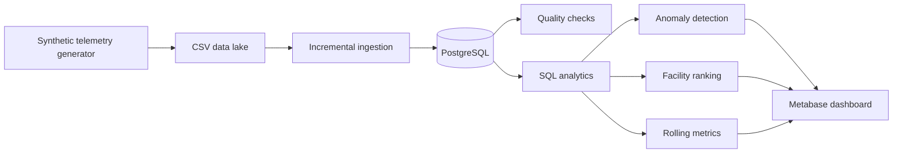
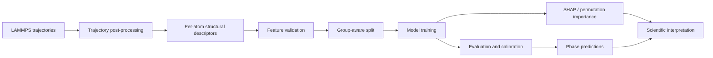
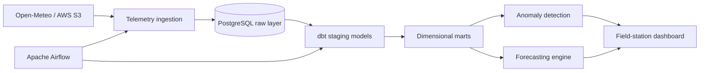
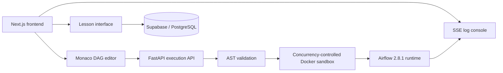
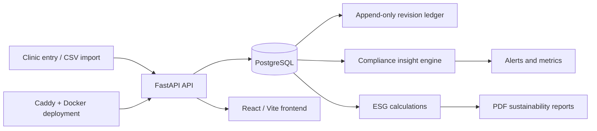
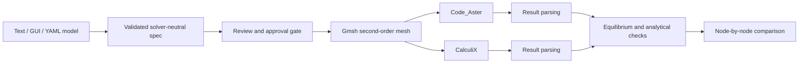
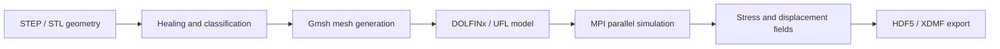

# Milad Ghaemi, PhD

**🌐 [Explore Interactive Portfolio & Engineering Workflows](https://miladgk.github.io/)**

**Computational Materials Physics | Data Engineering & Scientific ML | Helsinki, Finland**

I build reliable data platforms, scientific machine-learning workflows, and computational simulation tools. My work connects industrial analytics, atomistic simulation, finite-element modeling, and reproducible research software.

## Focus Areas

- **Data Engineering:** ingestion, PostgreSQL analytics, dimensional modeling, dbt, Airflow, data quality, and observability
- **Scientific ML:** feature engineering, anomaly detection, forecasting, classification, explainability, and model validation
- **Computational Materials:** ML interatomic potentials, kinetic Monte Carlo, molecular dynamics, electronic structure, and multiscale simulation
- **Computational Mechanics:** finite elements, geometry/mesh processing, solver verification, HPC, and MPI workflows

## Featured Public Projects

### [Industrial Energy SQL Pipeline](https://github.com/miladgk/industrial-energy-sql-pipeline)

An end-to-end data engineering platform for industrial energy facilities, combining high-volume ingestion, PostgreSQL analytics, SQL anomaly detection, automated quality checks, and Metabase reporting.

**Highlights:** approximately **6.3 million** five-minute sensor readings; incremental high-watermark ingestion; database-level conflict-safe inserts; normalized PostgreSQL schema; window functions and ranking analytics; pytest checks; Dockerized local setup; Metabase dashboard.

### [Amorphous Phase ML](https://github.com/miladgk/amorphous-phase-ml)

A materials-science machine-learning workflow for identifying polyamorphous phases in metallic glasses from atomistic simulation data.

**Highlights:** LAMMPS trajectory processing; **18 structural descriptors per atom**; group-aware splitting; HistGradientBoosting classification; **0.854 macro F1**; SHAP and permutation importance; calibration; deployment to new datasets.

### [Aether Climate Engine](https://github.com/miladgk/aether-climate-engine)

A real-time meteorological telemetry platform combining global station ingestion, statistical anomaly detection, forecasting, dimensional modeling, and an interactive field-station dashboard.

**Highlights:** Open-Meteo and AWS S3 ingestion; PostgreSQL raw layer; dbt staging/fact/mart models; Apache Airflow orchestration; linear, SMA, and EMA forecasting; 365-day year-over-year comparisons; pytest mocks; Bandit AST scanning; GitHub Actions CI.

## Selected Private & R&D Projects

These projects remain **strictly private**. The summaries below describe architecture and technical contributions without exposing confidential source code, private datasets, credentials, or operational details.

| Project | Area | Architecture / stack | Selected technical signal |
|---|---|---|---|
| **MLIP–KMC Research Review** *(Private)* | Scientific research | LaTeX, Python, structured evidence library | ML interatomic potentials, kMC, verification logs, reproducible review workflow |
| **Airflow Academy** *(Private)* | Data orchestration education | Next.js, FastAPI, Supabase, Docker, Airflow | Browser DAG execution, AST validation, isolated sandboxes, SSE logs |
| **Smileprint** *(Private)* | Compliance data platform | FastAPI, PostgreSQL, React, Docker, Caddy | Audit ledger, compliance insights, ESG calculations, PDF lineage |
| **Verified FEM Workbench** *(Private)* | Computational mechanics | Gmsh, Code_Aster, CalculiX, Docker | Review gates, analytical references, cross-solver verification |
| **Parallel Anatomy FEA** *(Private)* | HPC simulation | Gmsh, DOLFINx, UFL, PETSc, MPI, HDF5 | CAD/anatomy import, parallel cases, XDMF/HDF5 output |
| **Quantum ESPRESSO Advisor** *(Private)* | Electronic structure | Fortran, Python, Docker, Quantum ESPRESSO | Empirical benchmark ledger, input/log advisor, reproducible sweeps |
| **Tessera** *(Private)* | Mobile product engineering | Kotlin, Firebase, Room, Voronoi engine | Geometry gameplay, cloud services, privacy controls, monetization |

<strong>MLIP–KMC Research Review</strong> · LaTeX · Python · Scientific evidence management

A private research environment for a review of machine-learning interatomic potentials and kinetic Monte Carlo.

- Structured paper library with one record per paper
- Verification status and append-only verification logs
- Evidence-first policy for quantitative claims
- Citation snowballing and exclusion controls
- Reproducible manuscript builds, figures, references, and scanning utilities
- Research scope covering barrier prediction, MLIP surrogates, kMC, and multiscale materials simulation

<strong>Airflow Academy</strong> · Next.js · FastAPI · Supabase · Docker · Apache Airflow

An interactive browser platform for learning and executing Airflow DAGs. The private implementation includes a curriculum of **48 lessons across 7 chapters**.

- Custom AST validators for imports, DAG declarations, operators, dependencies, and context usage
- Ephemeral Docker execution with timeout and concurrency controls
- Synchronous and Server-Sent Events execution endpoints
- OAuth authentication and database/filesystem lesson fallback
- Curriculum authoring system for DAGs, ETL, operators, debugging, and TaskFlow
- Automated backend deployment workflow

<strong>Smileprint</strong> · FastAPI · PostgreSQL · React · Docker · Compliance analytics

A private compliance and sustainability platform for Finnish dental clinics.

- SQLAlchemy, Alembic, PostgreSQL, React, Vite, Tailwind, and Caddy
- Append-only audit history and retained revision records
- Checks for waste routing, duplicate invoices, cost spikes, and volume anomalies
- Data-lineage-aware PDF reporting and ESG workflows
- Automated backend and frontend testing

<strong>Verified FEM Workbench</strong> · Gmsh · Code_Aster · CalculiX · Physics-based verification

A solver-neutral finite-element workbench designed around explicit model review and physics-based verification.

- Verified cantilever, plate-with-hole, and elastoplastic-bar examples
- Global equilibrium and analytical reference checks
- Common mesh and nodal comparison across two solvers
- Optional retrieval-assisted repair of failed solver input

<strong>Parallel Anatomy FEA Pipeline</strong> · Gmsh · DOLFINx · PETSc · MPI

A private computational mechanics pipeline for anatomy/CAD geometry import, robust meshing, parallel simulation, and scientific result export.

- Geometry healing, volume classification, physical groups, and mesh sizing
- DOLFINx, UFL, PETSc, MPI, NumPy, Pandas, and HDF5
- Resumable parameterized cases and visualization-ready XDMF output

<strong>Quantum ESPRESSO Advisor</strong> · Fortran · Python · HPC benchmarking

A private computational-physics toolkit for reproducible Quantum ESPRESSO performance and correctness analysis.

- Fortran source modifications and native builds
- Docker-based development and benchmark environments
- k-point, hybrid-functional, relaxation, and ensemble experiments
- Empirical benchmark ledger with evidence paths
- CLI analysis of Quantum ESPRESSO inputs and logs
- Recommendations constrained to experimentally supported regimes
- Explicit reporting of unverified cases and limitations

<strong>Tessera</strong> · Kotlin · Firebase · Room · Voronoi game engine

A private Android application combining geometry-based puzzle gameplay, authentication, cloud data, local persistence, analytics controls, and monetization services.

- Kotlin Android application architecture with Voronoi-based gameplay
- Firebase Auth, Firestore, Crashlytics, App Check, Analytics, and Remote Config
- Room persistence for preferences, progress, and puzzle data
- Daily puzzle and competition repositories
- Adapty billing integration and privacy/consent controls
- Downloadable music and media playback components

## Technical Toolkit

## Engineering Principles

- Make data pipelines observable, repeatable, and idempotent.
- Treat scientific claims as evidence that must be traceable and verifiable.
- Validate simulations against physics, not only software exit codes.
- Prefer explicit limitations over unsupported conclusions.
- Keep private work private while communicating architecture and impact clearly.

## Publications

1. **Crystallization dynamics and interfacial structure during HiPIMS growth of thin Nb films on Cu** — *Materials Today Communications* (2026) · Atomistic MD, HiPIMS thin-film deposition, Nb/Cu superconducting RF interfaces · [Search on Google Scholar](https://scholar.google.com/scholar?q=Crystallization+dynamics+and+interfacial+structure+during+HiPIMS+growth+of+thin+Nb+films+on+Cu) · [Add DOI](https://doi.org/)
2. **Surface orientation effects on Cu blistering under high-fluence H ion irradiation** — *Acta Materialia* (2024) · Hydrogen blistering, ion irradiation, Cu surfaces, atomistic modeling · [Search on Google Scholar](https://scholar.google.com/scholar?q=Surface+orientation+effects+on+Cu+blistering+under+high-fluence+H+ion+irradiation) · [Add DOI](https://doi.org/)
3. **Comparative study of Nb film growth on Cu substrates using DCMS and HiPIMS** — *Surface and Coatings Technology* (2024) · Thin-film growth mechanisms, DCMS vs. HiPIMS, energetic deposition · [Search on Google Scholar](https://scholar.google.com/scholar?q=Comparative+study+of+Nb+film+growth+on+Cu+substrates+using+DCMS+and+HiPIMS) · [Add DOI](https://doi.org/)
4. **Notch-tip brittle-ductile transitions in metallic glasses** — *Extreme Mechanics Letters* (2022) · Metallic glasses, fracture mechanics, brittle-to-ductile transition · [Search on Google Scholar](https://scholar.google.com/scholar?q=Notch-tip+brittle-ductile+transitions+in+metallic+glasses) · [Add DOI](https://doi.org/)
5. **Investigation of grain boundary mechanical failure under strain and stress control** — *ECS Journal of Solid State Science and Technology* (2021) · Grain boundary mechanics, failure analysis, atomistic deformation · [Search on Google Scholar](https://scholar.google.com/scholar?q=Investigation+of+grain+boundary+mechanical+failure+under+strain+and+stress+control) · [Add DOI](https://doi.org/)
6. **Thermodynamic potentials and physical quantities of metallic glasses** — *Journal of Non-Crystalline Solids* (2020) · Amorphous alloys, thermodynamics, disordered systems · [Search on Google Scholar](https://scholar.google.com/scholar?q=Thermodynamic+potentials+and+physical+quantities+of+metallic+glasses) · [Add DOI](https://doi.org/)
7. **Short- and medium-range ordering in Cu-Zr and Ni-Zr metallic glasses** — *Journal of Non-Crystalline Solids* (2018) · Cu-Zr / Ni-Zr metallic glasses, structural ordering, polyamorphism · [Search on Google Scholar](https://scholar.google.com/scholar?q=Short-+and+medium-range+ordering+in+Cu-Zr+and+Ni-Zr+metallic+glasses) · [Add DOI](https://doi.org/)

## Contact

- GitHub: [@miladgk](https://github.com/miladgk)
- Portfolio: [miladgk.github.io](https://miladgk.github.io)
- LinkedIn: [Milad Ghaemi](https://www.linkedin.com/in/milad-ghaemikermani/)
- Google Scholar: [Publications](https://scholar.google.com/citations?hl=en&user=dzrQ6WsAAAAJ)
- Collaboration interests: data engineering, scientific machine learning, computational materials science, and computational mechanics.
